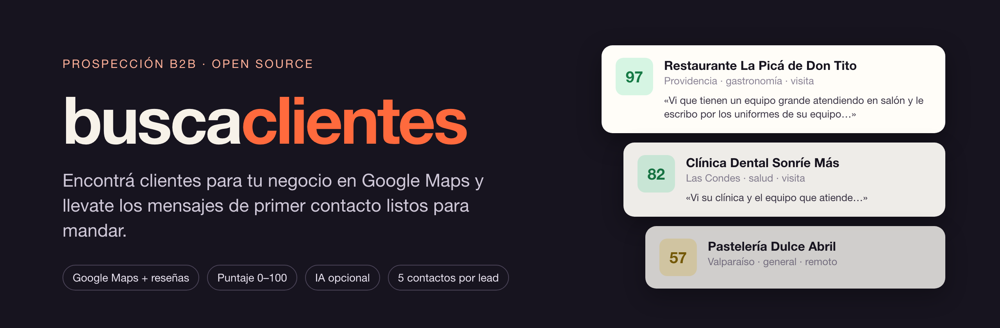
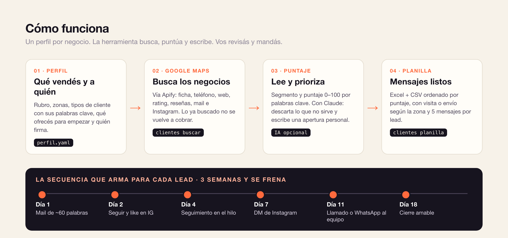
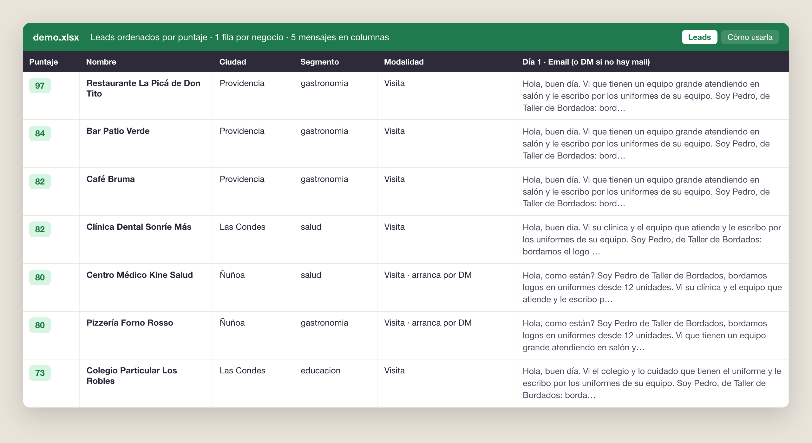
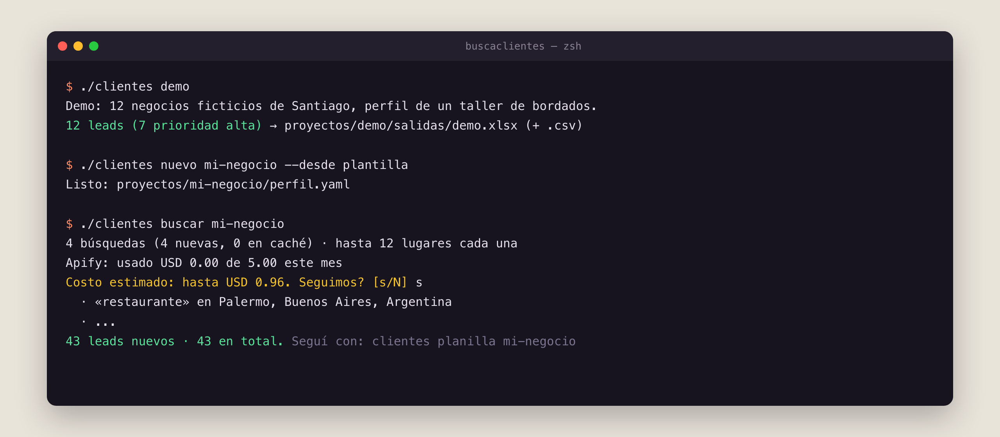

<p align="center"></p>

<p align="center">
  <a href="#probalo-en-un-minuto">Probalo</a> ·
  <a href="#instalación">Instalación</a> ·
  <a href="#el-perfil">El perfil</a> ·
  <a href="#con-claude-code">Claude Code</a> ·
  <a href="#cuidados">Cuidados</a>
</p>

<p align="center">
  
  
  
</p>

---

**buscaclientes** busca negocios de tu rubro en Google Maps, lee sus reseñas, les pone un puntaje según qué tan buen cliente parecen para vos y te deja, para cada uno, **cinco mensajes de primer contacto listos para revisar y mandar**.

Le decís qué vendés, a quién y en qué zonas. Te devuelve una planilla ordenada de mejor a peor, con el teléfono, el mail y el Instagram cuando son públicos. Si el negocio está en tu zona, el mensaje le ofrece una visita corta; si no, el envío de una muestra o de más información.

No manda nada sola. Los mensajes los revisás y los mandás vos, de a uno.

> Nació para que una tienda de fajas post-operatorias consiguiera cirujanos plásticos en Argentina: **138 consultorios de 8 ciudades, con reseñas y contactos, por USD 2,75**. Sirve para cualquier venta a negocios: proveedores de restaurantes, agencias, distribuidores, servicios para clínicas, gimnasios o colegios.

<p align="center"></p>

## Probalo en un minuto

Sin cuenta de nada y sin gastar: la demo arma la planilla de un taller de bordados que busca clientes en Santiago, con 12 negocios ficticios.

```bash
git clone https://github.com/julitomaker/buscaclientes.git
cd buscaclientes
./instalar.sh
./clientes demo
```

Abrí `proyectos/demo/salidas/demo.xlsx`:

<p align="center"></p>

Cada fila trae cinco mensajes, uno por columna:

| Día | Canal | Qué dice |
|---|---|---|
| 1 | Mail | Unas 60 palabras: algo específico del negocio, quién sos en una línea y **una sola pregunta de interés** |
| 2 | Instagram | Nada de mensaje: seguir la cuenta y dar like |
| 4 | Mail, en el mismo hilo | Prueba social y la oferta concreta (visita o muestra) |
| 7 | DM de Instagram | Corto, menciona el mail. Si no hay mail, es el primer contacto |
| 11 | WhatsApp o llamado | A quien maneja la agenda: secretaria, recepción, encargado |
| 18 | Mail, en el mismo hilo | Cierre amable. Y se frena |

## Qué necesitás

- **Python 3.10 o más nuevo** (Mac, Linux, cualquier VPS) o **Docker**.
- **Una cuenta de [Apify](https://apify.com)** para buscar en Google Maps. El plan gratis trae USD 5 por mes, que alcanza para unos 200 negocios con reseñas y contactos. El token está en *Settings → API & Integrations*.
- **Opcional: una clave de la [API de Claude](https://console.anthropic.com).** Con ella la IA lee cada negocio, descarta los que no sirven y escribe una frase de apertura personal. Sin clave funciona igual, con palabras clave y plantillas.

## Instalación

### Mac, Linux o VPS

```bash
./instalar.sh
```

Crea un entorno propio (`.venv`) y un archivo `.env` donde pegás tu `APIFY_TOKEN`. No necesita root. Si el servidor no tiene `python3-venv` (pasa en Ubuntu), instala las librerías en `./lib` sin tocar el Python del sistema.

Para usarlo desde cualquier carpeta:

```bash
ln -s "$PWD/clientes" ~/.local/bin/clientes
```

### Docker (VPS o cualquier nube)

```bash
cp .env.example .env          # y pegá tu token
docker compose run --rm clientes demo
docker compose run --rm clientes nuevo mi-negocio
```

Los proyectos se guardan en `./proyectos/`, fuera del contenedor.

## Uso

<p align="center"></p>

```bash
./clientes nuevo mi-negocio                    # crea proyectos/mi-negocio/perfil.yaml
./clientes buscar mi-negocio                   # estima el costo y pregunta antes de gastar
./clientes planilla mi-negocio                 # Excel + CSV en proyectos/mi-negocio/salidas/
```

| Comando | Qué hace |
|---|---|
| `clientes nuevo <proyecto> --desde <perfil>` | Arranca desde un ejemplo de `perfiles/`: `plantilla`, `fajas-cirujanos` o `bordados-uniformes` |
| `clientes buscar <proyecto> --zonas "Rosario, Argentina"` | Busca en otra zona. Los resultados se **suman** a los anteriores |
| `clientes importar <proyecto> lista.csv` | Suma una lista tuya (seguidores, una feria, contactos). Columnas: `nombre, ciudad, instagram, telefono, email, web, notas, segmento, seguidores` |
| `clientes planilla <proyecto> --sin-ia` | Arma la planilla sin usar la IA aunque haya clave |
| `clientes estado <proyecto>` | Cuántos leads hay y cuántos tienen mail, Instagram o teléfono |
| `clientes credito` | Cuánto te queda de Apify este mes |
| `clientes demo` | La demo con negocios ficticios |

**Lo que ya buscaste no se vuelve a cobrar:** cada búsqueda queda en `proyectos/<proyecto>/cache/`. Si cambiás el perfil y volvés a correr `planilla`, se recalcula todo gratis.

## El perfil

Todo lo de tu rubro vive en `proyectos/<proyecto>/perfil.yaml`. La [plantilla](perfiles/plantilla.yaml) está comentada línea por línea.

```yaml
negocio:
  nombre: Taller de Bordados
  presentacion: bordamos el logo en uniformes, desde 12 unidades y con muestra antes de producir
  prueba_social: bordamos para 40 empresas de Santiago      # un dato real, nunca inflado

busqueda:
  terminos: [restaurante, clínica dental, gimnasio]
  zonas: ["Providencia, Santiago, Chile", "Las Condes, Santiago, Chile"]

segmentos:                    # tipos de cliente, en orden de prioridad
  - id: gastronomia
    palabras: [restaurante, "caf[eé]", mozo, delantal]   # se buscan en nombre, categoría y reseñas
    gancho: Vi que tienen un equipo grande atendiendo en salón
    asunto: Delantales con su logo
    muestra_detalle: un delantal bordado con su logo

ofrecimiento:
  zonas_visita: [providencia, "las condes"]    # acá ofrece visita; en el resto, envío
```

Ejemplos completos para copiar:

- [`fajas-cirujanos.yaml`](perfiles/fajas-cirujanos.yaml): una tienda de fajas que busca cirujanos plásticos. Es el caso real que originó la herramienta, con los datos de la marca cambiados.
- [`bordados-uniformes.yaml`](perfiles/bordados-uniformes.yaml): un taller de bordados que busca restaurantes, clínicas, gimnasios y colegios.

## Con Claude Code

El repo trae una skill para [Claude Code](https://claude.com/claude-code). Instalala así:

```bash
cp -R skills/buscaclientes ~/.claude/skills/
```

Después pedile a Claude, en palabras normales, «buscame clientes para mi negocio en Google Maps». Claude:

1. Te hace las preguntas para armar el perfil.
2. Te dice cuánto va a costar y espera tu ok antes de buscar.
3. Corre la herramienta.
4. Revisa la planilla con vos y ajusta el perfil si los primeros resultados no tienen sentido.

## Por qué los mensajes son así

Siguen lo que muestran los estudios de cold email B2B ([Hunter](https://hunter.io/the-state-of-cold-email-2025), [Gong](https://www.gong.io/blog/4-data-backed-ways-to-increase-your-email-reply-rate-and-book-that-meeting), [Instantly](https://instantly.ai/cold-email-benchmark-report-2026)) y cómo venden los representantes de equipamiento médico:

- **Mails cortos** (40 a 80 palabras) y en texto plano.
- **Asuntos de 2 o 3 palabras**, sin signos ni emojis.
- **Pedir interés, no una reunión.** «Le interesaría que…?» rinde más que «tiene 15 minutos?».
- **Seguimiento en el mismo hilo**, que responde mejor que un recordatorio formal.
- **Listas chicas y personalizadas**: responden más del doble que los envíos masivos.
- **Ofrecer algo sin compromiso**, como una muestra, una visita de 10 minutos o una simulación.

Son puntos de partida: medí tus resultados y cambiá las plantillas en el perfil (`mensajes:`).

## Cuidados

- **WhatsApp:** nada de envíos masivos ni en frío desde el número de un bot o de la API oficial. Meta baja la calidad del número y lo bloquea si recibe denuncias. A mano, de a uno.
- **Salud y sector público:** en muchos países está prohibido pagarles comisión a médicos o funcionarios por derivar o recetar (en Argentina, Ley 17.132). El beneficio tiene que ser para el cliente final.
- **Spam y datos:** solo datos públicos de negocios, pocos mensajes, desde una casilla real con nombre y firma, y sacando de la lista a quien lo pida.
- **Promesas:** nada que no puedas demostrar. Los datos de prueba social tienen que ser reales.
- **Costos:** Apify y la IA cobran por uso. La herramienta estima el costo y pregunta antes de gastar.
- **Claves:** van en `.env`, que está en `.gitignore`. Nunca lo subas ni lo compartas.

Los datos salen de Google Maps a través de Apify, que publica [sus condiciones](https://apify.com/compass/crawler-google-places). Usalo con criterio y respetando las reglas de tu país.

## Cómo está hecho

```
clientes                comando principal
instalar.sh             instalador (venv, o ./lib si no hay python3-venv)
Dockerfile · docker-compose.yml
buscaclientes/
  cli.py                comandos
  apify.py              Google Maps vía Apify, con caché
  puntaje.py            segmento, puntaje 0-100, localidad, visita o remoto
  mensajes.py           plantillas → secuencia de 5 mensajes
  ia.py                 análisis opcional con Claude (frase de apertura, descarte)
  planilla.py           Excel + CSV
perfiles/               plantilla y ejemplos
ejemplos/               datos ficticios para la demo
skills/buscaclientes/   skill para Claude Code
docs/                   imágenes del README (y su fuente en HTML)
```

## Contribuir

Los perfiles de rubros nuevos son lo que más suma: ópticas, veterinarias, estudios contables, constructoras. Abrí un PR con el tuyo en `perfiles/`, sin datos privados.

Bugs e ideas, en [issues](https://github.com/julitomaker/buscaclientes/issues). Antes de un PR corré `./clientes demo` y fijate que la planilla salga bien.

## Licencia

[MIT](LICENSE). Usalo, cambialo y compartilo.
